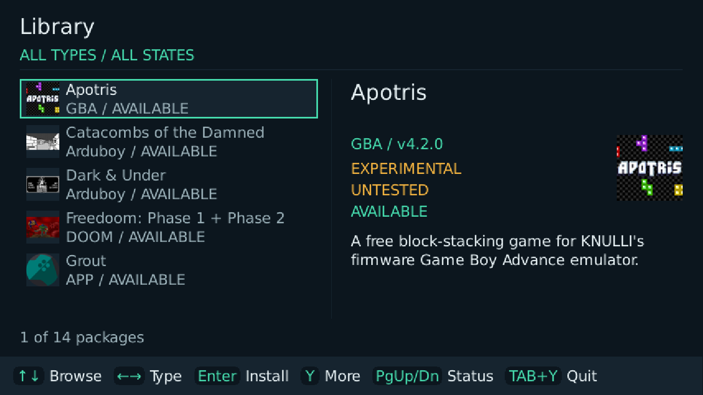
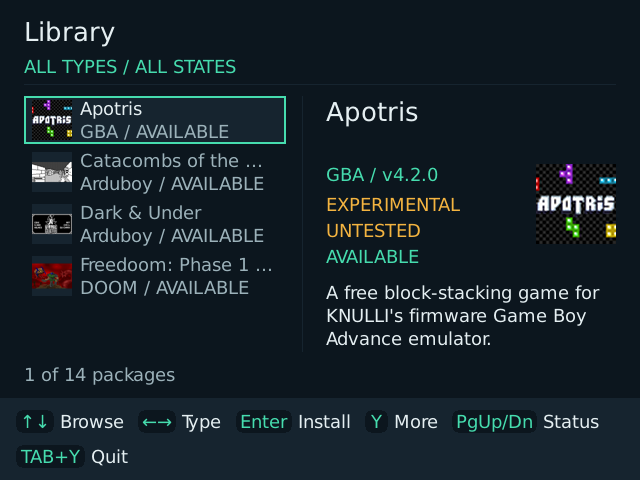
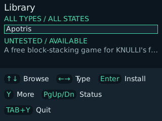

# Knulli App Store

A community package manager for [Knulli](https://knulli.org/) utilities, themes, integrations, and reviewed free games. Install, manage, update, repair, and remove reviewed packages with a controller or the CLI.

The Store verifies downloads and journals file changes for rollback. It never runs downloaded installers. Installed apps are **not sandboxed**.

## Devices and release

Current version: **[v2026.11.04](https://github.com/jellydn/knulli-app-store/releases/tag/v2026.11.04)**. Download the [one installable ZIP](https://github.com/jellydn/knulli-app-store/releases/download/v2026.11.04/knulli-app-store-knulli-aarch64-glibc-sdl2-experimental-v2026.11.04.zip) and its [SHA256SUMS.txt](https://github.com/jellydn/knulli-app-store/releases/download/v2026.11.04/SHA256SUMS.txt) from the same release. Packages and device support remain **experimental**, even for a tagged Store release.

This version includes responsive Library layouts, offline artwork and game-system labels, a header showing the current category/status, measured footer hints, complete paged reviews, and fourteen reviewed packages. The [CPU interval sampler and benchmark guide](docs/idle-cpu-benchmark.md) make the remaining performance tests reproducible; no new handheld CPU or battery result is claimed. See the [2026-11-04 catalogue audit](docs/release-audit-2026-11-04.md) for versions, blocked updates and security limits.

One KNULLI AArch64/glibc/SDL2 distribution replaces the old device-named ZIPs. Historical assets and hardware reports remain scoped to the artifacts actually tested:

| Target | Display | Evidence |
| --- | --- | --- |
| [TrimUI Smart Pro](docs/trimui-smart-pro.md) | 1280×720 | Owner confirmed eight exact app versions on 2026-10-30, not every version now listed. Current Store physical controls/audio and updated-app checks remain outstanding. |
| [MagicX Zero 28](docs/magicx-zero-28.md) | 640×480 | Historical diagnostic confirms Knulli, AArch64, display, and SDL controller; full current-build GUI testing remains incomplete. |

**Knulli is the only implemented firmware profile.** Device GUI builds require AArch64, glibc, and system SDL2, SDL2_image, and SDL2_ttf; SDL2_gfx is linked statically. Do not replace firmware libraries.

New-build asset names:

- `knulli-app-store-knulli-aarch64-glibc-sdl2-experimental-VERSION.zip`
- `SHA256SUMS.txt` (separate checksum file, not another device distribution)

The build gates required glibc symbols at 2.34; SDL2_gfx is static. One ZIP does not mean all hardware is compatible. Successful `main` workflows publish dated experimental pre-releases. Physical footer/device testing remains outstanding; publication is not a hardware-tested badge. See [distribution, security and legacy migration](docs/store-distribution.md).

## Install and use

1. Download the compatibility-profile ZIP and checksum file into one directory on your computer:

   ```sh
   sha256sum --ignore-missing -c SHA256SUMS.txt
   ```

   Continue only if your ZIP reports `OK`.
2. Shut down Knulli and connect its data card to your computer.
3. Extract the ZIP into `/userdata/roms/ports`. Check for:
   - `Knulli App Store.sh`
   - `knulli-app-store/knulli-app-ui`
   - `images/Knulli App Store.png`
4. Safely eject, start Knulli, refresh game lists or reboot, then open **Knulli App Store** in **Ports**.
5. Select an app, read its warnings, and confirm the action.

The status line shows preparation, download, verification, extraction, file installation, and finalization. Download percentage measures received bytes against the pinned release size; installation percentage measures processed release files, not the whole operation. Other phases show no estimated percentage. Controls stay locked until the operation ends. Success appears as a brief notice; a failure stays visible for review or retry.

An existing copy offers **Manage existing**: matching release files become owned without reinstalling; uncertain files remain unmanaged and are backed up before replacement. Empty directories do not count as external copies. **Repair** restores pinned code and keeps declared data. **Uninstall** removes owned files, restores originals where applicable, and keeps declared data. Close apps before Store operations.

The GUI requests one menu refresh on exit if package operations changed the game list, not after each install. One-shot CLI commands still refresh immediately. Menu refresh **accepted** means queued, not completed. Refresh or restart EmulationStation if an entry is missing.

### Update the Store

At the standard `/userdata/roms/ports/knulli-app-store` location, a build with self-update support offers a **Knulli App Store** entry. Confirm **Check for updates**, then **Update**; exit and reopen afterward. New builds select the common compatibility profile, including official experimental pre-releases. Asset size and SHA-256 come from GitHub, not an independent update signing key. Old device-named binaries cannot discover the new asset; use the [verified manual migration](docs/store-distribution.md#legacy-migration).

For an older build, custom location, or **text file busy** failure, verify the ZIP and shut down Knulli before extracting it. Replace launcher, icon, binaries, catalogue, signature, and packaged guide together. Do not delete installed apps, settings, or `/userdata/system/knulli-app-store`. See [self-update safety and recovery](docs/security-model.md#store-self-update).

## Controls

The **Library** uses a stable package list beside a persistent detail pane where space permits. Compact outputs use one column and a fixed selected-package summary. A mint outline marks focus. The header shows the current category/status intersection, such as **GAMES / INSTALLED**; the measured footer owns the controls. **All types / Games / Apps** categories and **All states / Ready / Installed** filters each retain selection. Apps include utilities, themes and integrations; a game picker is still an app. Technical review status, test evidence and installation state are separate. More and confirmation screens page complete warning/recovery text with a visible line range. No setup wizard or custom mapping editor is needed.

Rows and the detail pane show bundled publisher logos or game thumbnails, including before installation and without a network connection. Packages without suitable reviewed artwork use initials tiles, not invented publisher logos. Games show their system (GBA, Arduboy or DOOM) instead of a generic game label. Artwork sources and licences are recorded in [the thumbnail notice](internal/sdlui/assets/thumbnails/NOTICE.txt) and included in device packages' `README.txt`.

| Action | Knulli controller | Desktop keyboard |
| --- | --- | --- |
| Browse packages | D-pad up/down | Up/Down |
| Category: All types, Games, Apps | D-pad left/right | Left/Right |
| Filter All, Ready, Installed | L1/R1 | Page Up/Page Down |
| Read previous/next review page | L1/R1 while reviewing | Page Up/Page Down |
| Review or confirm | A | Enter |
| Cancel or go back | B | Escape |
| Open More; export diagnostics inside More | Y | Y |
| Quit | Hold Select, then press Y | Hold Tab or F5, then press Y |

The first A press opens confirmation, not installation. **More** contains details and secondary actions; **Issue** opens health first. Y exports diagnostics directly on empty-catalogue and blocked-controller screens. Face labels follow the active Knulli Ports layout; the launcher compensates once for default or Xbox mode. Legacy `controller-mappings.json` files are ignored and left unchanged. See [frontend design](docs/adr/0010-gabagool-knulli-frontend.md) and [device reports](docs/real-device-tests.md).

To test a separately prepared, unpublished build without replacing the production Store, use the [isolated device-test procedure](docs/ui-redesign-device-test.md). Normal release ZIPs are not isolated test packages.

### Current UI screenshots — desktop rendering only

These are real renderer-backbuffer captures from the current UI source used for this release, using Linux software SDL, keyboard input and a disposable KNULLI fixture. They are **not captures from a handheld or the signed ARM64 executable**. Firmware/device/architecture values are fixture data and overrides, not detected hardware evidence. Text and keyboard hints follow actual drawable size; short compact summaries are completed in More.

**1280×720: wide Library with offline artwork and a detail pane.**



**640×480: two-pane boundary, with hints wrapped into two rows.**



**320×240: compact single-column Library and complete three-row hints.** This is the initial layout target, not a newly supported or tested device.



See [capture commands and limitations](docs/desktop-verification.md#release-screenshots).

## Catalogue and safety

On 2026-10-30 (Asia/Singapore), the [owner reconfirmed](https://ampcode.com/threads/T-01a184fd-5491-7371-9d0d-5d2a4bbddb02) eight exact app versions on TrimUI Smart Pro, using the previously confirmed Knulli AArch64 1280×720 matrix. This includes Picker 0.2.2, Grout 5.4.1.0, historical retroshelf 0.6.3, RAOfflineProxy 2.3.0-alpha1 and Handheld Link Cores (mGBA Dual) 2026.10.29.1. It does not verify retroshelf 0.6.10, WebUI 1.2.2, zitch or every later Store build. MagicX Zero 28 and other matrices remain untested. Package testing does not establish separate lifecycle results or remove disclosed safety limits. All **fourteen entries** (ten apps and four game packages) remain **experimental**:

| Package | Current manifest version | Purpose |
| --- | --- | --- |
| Grout | 5.4.1.0 | Connect to a RomM 5.4.1+ server; [release review](docs/grout-5.4.1.0.md) |
| Handheld Link Cores (mGBA Dual) | 2026.10.29.1 | Manual RetroArch core loading only; no system patches; [setup and review](docs/handheld-link-cores.md) |
| PlayTime | 1.0.0 | Track game play time |
| Knulli WebUI | 1.2.2 | Private HTTP file/control service; configure credentials offline before first start; [current review](docs/release-audit-2026-11-04.md#webui-122) |
| Random Game Picker | 0.3.0 | Select from existing EmulationStation games; optional saved YOLO mode |
| RetSend | 1.0.0 | Transfer files over local Wi-Fi with LocalSend peers |
| PocketCurator | 1.1.2 | Manage your ROM collection; requires PortMaster |
| RAOfflineProxy | 2.3.0-alpha1 | Offline casual RetroAchievements; requires Python 3.12 and pygame; [release review](docs/raofflineproxy-2.3.0-alpha1.md) |
| retroshelf | 0.6.10 | Sync game sessions; requires an account and Wi-Fi; [current review](docs/release-audit-2026-11-04.md#retroshelf-0610) |
| zitch | 0.3.0 | Browse and install your itch.io library; requires PortMaster and glibc 2.38+; Knulli game launch untested; [release review](docs/zitch-0.3.0.md) |

The **Games** category includes four experimental packages (five playable games):

| Game | Version | Firmware runtime |
| --- | --- | --- |
| Apotris | 4.2.0 GBA | RetroArch + mGBA |
| Catacombs of the Damned | 1.0 | RetroArch + Arduous |
| Dark & Under | 2.0.2 | RetroArch + Arduous |
| Freedoom: Phase 1 + Phase 2 | 0.13.0 | RetroArch + PrBoom |

All downloads are reviewed original-publisher archives, not Nursery or PortMaster assets. Apotris and the two Arduboy games use the owner-approved [missing-publisher-checksum exception](docs/adr/0012-reviewed-game-checksums.md): the Store pins downloaded size/SHA-256 and warns that this trusts publisher HTTPS at review time. They have no physical-device test reports. The owner reports both Freedoom phases work well on TSP with v2026.11.02-f193885, but supplied no firmware/resolution or lifecycle/save results; its exact-matrix badge remains UNTESTED. Freedoom Phase 1 has a Store-created entry; after refreshing game lists, find Phase 2 in PrBoom/Freedoom. Saves/settings stay after removal. Apotris custom audio is preserved, but Repair restores the pinned ROM without running rebuild tools. See the [releases, paths and full exclusions review](docs/free-games-review.md).

Firmware, architecture, ABI, and runtime dependencies still gate installation. Device identity and display scope are advisory. **UNTESTED** means no passed report matches the exact package version and device matrix. See the [evidence and its limits](docs/real-device-tests.md#2026-10-30-current-owner-confirmation). [Picker 0.3.0](https://github.com/jellydn/knulli-random-game-picker/releases/tag/v0.3.0) adds optional persistent YOLO mode: one pick starts the fresh launch check without preview, cancel or reroll. It defaults off; saved-on runs open Settings so it can be disabled. Normal preview/Play/reroll/back remains unchanged when off. Tools and Emulators exclusions, `state/` preservation and the single exact-path ES request remain. It still requires glibc ≥2.34, firmware SDL2/image/ttf/gfx, and the loopback EmulationStation API. Picker 0.2.2 device evidence is historical; 0.3.0 is UNTESTED on hardware. See the [current release contract](docs/random-game-picker-go-contract.md). Its requirements are separate from the Store's.

PortMaster remains an external provider: the Store does not import its catalog, use its release archives, or modify its installations. [ADR 0011](docs/adr/0011-reviewed-free-games.md) allows directly reviewed native free games and legally redistributable homebrew ROMs/game data from original publishers. Games require verified code and asset rights; commercial game files, unclear rights and ROM-download services remain excluded. The new `game` manifest type needs a compatible Store binary; do not copy a game-containing index into an older Store release. Use only ROMs you have the right to use and servers you trust.

- Reviewed manifests pin HTTPS release URLs, exact sizes, and SHA-256 hashes. Device builds verify a signed bundled catalogue.
- Archives are bounded to 512 MiB compressed and installed; unsafe paths, links, and non-regular entries are rejected.
- Store writes stay below `/userdata`, rejecting existing symlinks in write paths. Downloads are verified and staged before journaled mutations; installed state is written last.
- Declared data remains. Menu entries are removed only when Store-created and unchanged; pre-existing metadata is not overwritten.
- Candidates are read-only. Community approval, technical status, and exact-device tested badges are separate.

### Upstream-managed apps

**PocketCurator, RAOfflineProxy, retroshelf, zitch, and Knulli WebUI** are actionable experimental packages, not read-only candidates. The Store verifies pinned installation bytes, but does not control later setup, runtime writes, downloads, or self-updates. Repair restores pinned code and keeps declared data.

- PocketCurator can permanently delete ROMs: back up first. For an older launcher-path failure, update the Store to v2026.10.24.4 or later, close PocketCurator, then use **More → Repair**. See the [native launch investigation](docs/real-device-tests.md#2026-10-24-pocketcurator-ssh-investigation).
- RAOfflineProxy lacks an independent publisher checksum; its pinned hash was checked against GitHub's asset digest. This trusts GitHub and the publisher's account.
- retroshelf's license is unverified; the Store downloads directly from its publisher without redistribution.
- zitch uses private `Ports/Zitch` with a verified launcher-path patch and bundled menu artwork. Its launcher disables frontend self-updates, but downloaded games execute outside Store checks. Knulli game launch is untested; ROM/core launch is muOS-only. Close zitch and its games before Store operations. Removal keeps account data and games under `Zitch/zitch/home`; it does not sign you out or erase credentials.
- RAOfflineProxy and retroshelf require manual hook/service cleanup before removal. Read the Store's cleanup messages and the [RAOfflineProxy](catalogue/packages/io.github.misantronic.raofflineproxy.json) / [retroshelf](catalogue/packages/org.retroshelf.knulli.json) manifest warnings. Declared read-only checks block removal; the Store never runs cleanup scripts.
- Knulli WebUI starts a private HTTP service from Tools, without autostart. Defaults have no authentication and enable file writes and remote input. Configure it before starting, use only a trusted private network, and stop it before Store operations. Removal keeps configuration and credentials. See the [WebUI setup and security review](docs/knulli-webui-1.2.1.md).

See [package manifests](catalogue/packages/), [package contribution guidance](docs/how-to-add-a-package.md), [RetSend review](docs/retsend-upstream-1.0.0.md), and the [security model](docs/security-model.md) for preserved paths and boundaries.

The daily [catalogue update check](https://github.com/jellydn/knulli-app-store/actions/workflows/catalogue-updates.yml) runs at 12:00 PM Singapore time. It verifies eligible experimental release proposals, tests changed metadata, and drafts a PR for human review; ambiguous releases and patch-dependent packages remain manual. It never approves or merges a package. After human merge to `main`, successful normal checks automatically publish an experimental prerelease; full releases require a `v*` tag. See [contribution guidance](CONTRIBUTING.md) for permissions and validation.

## Build and test

Use **Go 1.27.3** with **Staticcheck 0.8.2** to match CI and local hooks. The analyzer supports the updated Go export format. GUI builds and `make check` also need SDL development files. On Debian or Ubuntu:

```sh
sudo apt-get install libsdl2-dev libsdl2-image-dev libsdl2-ttf-dev libsdl2-gfx-dev zip
make check             # Format, vet both tag sets, race tests
make build             # Static host CLI: build/knulli-app
make catalogue         # Validate manifests and build the index
make catalogue-check   # Require two byte-identical index builds
make cover             # Test files in production packages; ≥70% total coverage
go test -race -tags sdl ./...
make gui               # Keyboard GUI with a scratch device root
make gui GUI_DEVICE=magicx-zero-28 GUI_RESOLUTION=640x480
make walkthrough       # Offline flow and screen evidence
```

`build/` is ignored; do not commit generated output. Git diff cannot replace `make catalogue-check`. Desktop fixtures do not prove physical controls or native device behavior. See [desktop verification](docs/desktop-verification.md); add `WALK_FLAGS=--install` for network-backed lifecycle flows.

### CLI examples

```sh
./build/knulli-app --help
./build/knulli-app validate catalogue/packages/io.github.unitreign.playtime.json
# On Knulli, with permission to write below /userdata:
./build/knulli-app install package.json
./build/knulli-app adopt package.json       # Manage existing
./build/knulli-app repair package.json
./build/knulli-app update package-v2.json
./build/knulli-app uninstall org.example.package
```

Platform overrides require known facts. `-root` redirects device paths to a trusted fixture root for tests.

## Limits and troubleshooting

- Native GUI behavior, physical controls, and package lifecycle results need their own evidence; earlier reports do not verify every current build or another device.
- Installed apps have no runtime sandbox. Cleanup checks cover declared paths, not every custom configuration.
- The catalogue uses a per-build signing key; independent catalogue updates need a long-lived key strategy. Self-update has a separate GitHub trust boundary.
- Local root access and hostile processes racing filesystem checks remain outside installer protections.
- Removing a package from the catalogue does not remove its files or data. The CLI can uninstall it by its saved package ID.

Inspect `/userdata/system/logs/knulli-app-store.log`; use **More → Y** to export diagnostics under `/userdata/system/knulli-app-store/diagnostics/`. Logs are bounded and redacted, but inspect exports before sharing. Recovery limits are in the [security model](docs/security-model.md).

## Contribute and learn more

- [Contributing](CONTRIBUTING.md) and [manifest review](docs/manifest-review.md)
- [Architecture](docs/architecture.md), [decisions](docs/adr/), and [codebase map](.planning/codebase/ARCHITECTURE.md)
- [Issues](https://github.com/jellydn/knulli-app-store/issues)

Report security issues privately to the owner; do not post credentials, ROMs, or private data.

## License

[MIT](LICENSE) · Copyright © 2026 [Huynh Duc Dung](https://github.com/jellydn). Installed packages have their own licenses.
